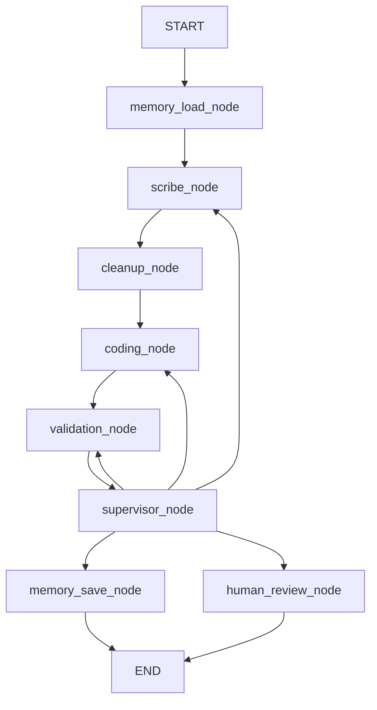

# Doctor Office - Agentic AI Clinical Assistant

A prototype system for clinical documentation and coding assistance using LLMs.

## Model Setup

The LLM weights are **not** included in this repository (they are too large for Git).

1. Install dependencies:
   ```bash
   pip install huggingface_hub
   ```

2. Download the model:
   ```bash
   python scripts/download_model.py
   ```

The model will appear in `models/`. Update your config to point to the correct `.gguf` file.

## Project Structure

```
doctor_office/
├── app/              # Streamlit application
├── data/             # Data files (chroma DB, patient data)
├── docs/             # Documentation
├── models/           # LLM models (gitignored - download separately)
├── scripts/          # Utility scripts
├── src/              # Source code
│   ├── agents/       # LangGraph agents
│   ├── memory/       # Patient memory system
│   ├── rag/          # RAG components
│   ├── tools/        # Clinical tools
│   └── utils/        # Utilities
└── tests/            # Test suite
```

## Quick Start

```bash
# Install dependencies
pip install -r requirements.txt

# Download model
python scripts/download_model.py

# Run app
streamlit run app/streamlit_app.py
```

## Architecture

The pipeline uses a LangGraph-based multi-agent architecture with a zero-LLM Supervisor:



**Key Components:**
- **Scribe Agent**: Generates SOAP notes from patient context and chief complaint
- **Cleanup Node**: Deterministic grounding check — removes hallucinated conditions
- **Coding Agent**: Refines ICD-10 and suggests CPT codes
- **Validation Node**: Checks ICD-10 grounding, CPT appropriateness, symptom coverage
- **Supervisor Node**: Zero-LLM router — handles retries, auto-fixes, escalation
- **Memory System**: Draft/approved visit split — only physician-approved visits become longitudinal context

**Safety Invariants:**
- Synthetic-data guard (`ALLOW_REAL_PHI=false`) refuses unmarked patient records
- Draft visits never seed longitudinal context
- Supervisor is deterministic — no LLM-based routing
- Auto-fixed codes are always re-validated before finalization

## How to Run Tests

```bash
# Run all tests
python -m pytest tests/ -v

# Run supervisor tests only (fast, no LLM)
python -m pytest tests/test_supervisor.py -v

# Run with coverage
python -m pytest tests/ --cov=src --cov-report=term-missing
```

## Environment Variables

| Variable | Default | Description |
|----------|---------|-------------|
| `LLM_BASE_URL` | `http://127.0.0.1:11434/v1` | OpenAI-compatible API endpoint |
| `LLM_MODEL_NAME` | `qwen2.5:1.5b` | Model identifier for Ollama |
| `LLM_FAST_MAX_TOKENS` | `384` | Max tokens for fast mode |
| `LLM_QUALITY_MAX_TOKENS` | `384` | Max tokens for quality mode |
| `RAG_TOP_K` | `2` | Number of RAG documents to retrieve |
| `ALLOW_REAL_PHI` | `false` | **Never set true outside isolated dev** |

Create a `.env` file from `.env.example` to override defaults.

## Deployment Target

**Physician Workstation Only**

This prototype is designed for local execution on a physician's workstation:
- Single-user, no authentication
- Models served via local Ollama (`http://127.0.0.1:11434`)
- Data stored locally (ChromaDB in `data/chroma_db/`, memory in `data/memory/`)
- No network services exposed
- Not suitable for shared servers or cloud deployment without authentication

## Prototype Disclaimer

**This is a prototype system for research and development purposes only.**

- Not intended for production clinical use
- Has not undergone formal security audit
- Must not be used with real patient data in any clinical setting
- Synthetic data only — real PHI is refused by the pipeline guard
- Physician review and approval required before any output becomes part of patient history
